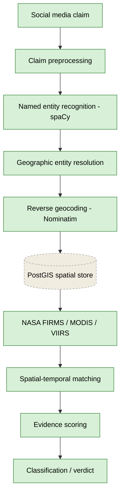

# Architecture

This document describes the intended full pipeline and marks which parts are
implemented in Week 2 versus planned for later.

## Pipeline diagram

Green = currently implemented. Dashed/grey = planned.

## Currently implemented (Week 2)

- **Claim preprocessing** — load synthetic claims from CSV.
- **NER (spaCy)** — `src/ner.py`, baseline `en_core_web_sm`, GPE/LOC/FAC.
- **Geographic entity resolution** — `src/location_resolution.py`, candidate
  ranking with light contextual boosting (kept separate from the baseline).
- **Reverse geocoding** — `src/geocode.py`, Nominatim with caching + rate limit.
- **NASA FIRMS / MODIS / VIIRS** — `src/firms.py` (VIIRS NOAA-20 default),
  `src/sensor_comparison.py` (MODIS vs VIIRS NOAA-20/21).
- **Spatial-temporal matching** — `src/verify.py` (Haversine + threshold),
  `src/threshold_experiment.py` (threshold sensitivity).
- **Evidence scoring** — `src/evidence.py`, transparent weighted score + the
  structured evidence record.
- **Classification / verdict** — conservative verdicts: `SUPPORTED`,
  `INSUFFICIENT_EVIDENCE`, `LOCATION_AMBIGUOUS` (`CONTRADICTED` reserved, not
  emitted).

## Planned (not yet implemented)

- **PostGIS spatial store** — schema and example queries exist in `database/`,
  but the live pipeline still runs on CSV files. Loading data into PostGIS and
  querying it from Python is future work.
- **LLM-based contextual classification** — not implemented; the current score
  is a transparent formula, not a model.
- **Multi-hazard verification** — only wildfire is verifiable. Flood, drought,
  air quality, and deforestation are defined in `config/claim_taxonomy.json`
  as planned extensions with candidate NASA products.
- **FIRMS archive retrieval** — only NRT (~last 2 months) is queried today.
- **Real sourced claim corpus** — the current dataset is synthetic.

## Data artifacts

| File | Produced by | Status |
|------|-------------|--------|
| `data/wildfire_claims.csv` | hand-authored (synthetic) | input |
| `data/ner_results.csv` | `src/ner.py` | generated |
| `data/ner_evaluation.csv` | `src/evaluate.py` | generated |
| `data/location_evaluation.csv` | `src/location_experiment.py` | generated |
| `data/verification_results.csv` | `src/main.py` | generated |
| `data/evidence_records.csv` | `src/evidence.py` | generated |
| `data/sensor_comparison.csv` | `src/sensor_comparison.py` | generated |
| `data/research_metrics.csv` | `src/research_metrics.py` | generated |
